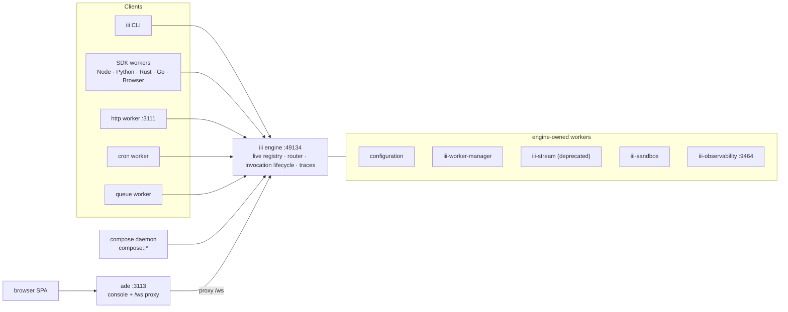

# iii: the whole system, the company thesis, and the worker ecosystem

> Working notes. Written 2026-10-26 against `iii-hq/iii` at `9dc4f03b` (v0.25.0), the live docs at
> `iii.dev/docs` (0.25.x Latest and 0.26.x Next), the public roadmap, the manifesto, and
> `iii-hq/workers` main. Companion file: [`iii-issues.md`](./iii-issues.md).
>
> Legend: **[verified]** means I read it in source or fetched the cited page. **[inferred]** means it
> is my reading of the architecture, not a direct quote. Everything else is quoted or paraphrased
> from primary material.

---

## 1. The one-paragraph version

iii is a single Rust engine plus one open protocol (JSON over WebSocket) and exactly three
primitives: **Worker**, **Trigger**, **Function**. A worker is any process that connects to the
engine and registers functions and triggers. A function is a named unit of work (`orders::validate`).
A trigger is anything that causes a function to run (HTTP, cron, queue, state change, stream, direct
call, another function). The engine keeps a live registry, routes every invocation, and traces across
languages and processes. Every capability that normally arrives as its own product category (queue,
cron, state, database, sandbox, browser, agent, UI) is instead installed as a worker from a public
registry with one command: `iii trigger compose::add worker=<name>`. The engine is the registry, the
protocol is the wire, and observability is the wire protocol. **[verified]**

Pronounced "three eye". Company: Motia LLC (site footer); some metadata says III, Inc. See issue I-06.

---

## 2. The manifesto, and what the company is actually betting on

The manifesto (`iii.dev/manifesto`) is unusually specific about the bet. Its claims, in order:

1. **"Systems engineering is integrations."** Every new capability arrives as its own category with
   its own semantics, operational model, and integration tax against everything already installed.
2. **"Three primitives are enough."** Worker, trigger, function. Queues, cron, streaming, sandboxing,
   observability, agents, business logic, devices, UIs, and anything not yet imagined are built from
   those three.
3. **"Paradigms win by collapsing categories."** Unix collapsed to "everything is a file", React to
   "everything is a component", HTTP to "request and response". iii makes the same bet for the whole
   stack.
4. **"Have a need? Add a worker."** Some workers are deterministic code, some are stochastic agents.
   The semantics live in the functions, not in the category.
5. **"Quadratic to linear."** Four services means six possible integrations, twenty means 190. A new
   worker joins by opening one connection, so adding four or twenty costs the same: zero.
6. **"Same contract, both sides of the house."** App teams register functions and triggers. Platform
   teams publish workers. Both use the identical contract, so the integration work between teams
   disappears.
7. **"Live by default."** Registration makes functions callable everywhere immediately; disconnect
   removes them. No stale specs, no propagation delay, no disconnected log streams.
8. **"Any language. Any runtime. One system."** A TypeScript worker calls a Python worker the same way
   it calls another TypeScript worker.
9. **"Humans and agents share one mental model."** A new engineer is productive on day one; an agent
   can reason about the whole system in one context window because there is one primitive set and one
   always-accurate source of truth for what exists.
10. **"Agents are workers."** An agent's tools are functions, its memory is state, its orchestration is
    triggers, and the harness is the system. It can register a worker at runtime and use it
    immediately.
11. **"`compose::add` is the npm moment for systems."** What you install is not a library, it is a
    running participant.
12. **"AI is the forcing function."** The category-shopping era (evaluate, procure, integrate, repeat)
    ends; one protocol, three primitives, and a registry of workers that compose without coordination.

**The commercial reading [inferred].** This is a classic open-core plus distribution play:

| Layer | Artifact | License | Strategic role |
|---|---|---|---|
| Runtime | `engine/` + `iii` CLI | ELv2 | The thing everyone must run; cannot be resold as managed iii |
| Client surface | SDKs (Node, browser, Python, Rust, Go) | Apache-2.0 | Maximize adoption, no legal friction to embed |
| Distribution | `workers.iii.dev` registry | Apache-2.0 workers | The "npm moment"; whoever owns the registry owns the default capability set |
| Flagship app | `harness` + `ade` + providers | Apache-2.0 | Proves the thesis with a real agent product, not a demo |
| Hosted | iii Cloud (`iii cloud`, private source) | commercial | Monetizes operators who do not want to run the engine |
| Docs / site | `docs/`, `website/` | Apache-2.0 | The sales surface and the agent-readable knowledge base |

The registry is the moat. The engine is deliberately small, the SDKs are deliberately permissive, and
the registry is where capability gravity accumulates. That is why `compose::add` is framed as the npm
moment rather than as a package manager detail.

---

## 3. The primitives, precisely

### Worker

Any process that opens a WebSocket to the engine and registers functions or triggers. It is not a
microservice, a job runner, or a sidecar. It can be a long-lived server, a short-lived process that
registers, runs once, and exits, a browser tab, or a microVM. Worker isolation is real: one worker
crashing drops only its own registrations and does not affect the rest. **[verified]**

### Function

A named handler with a stable ID. `service::name` is convention, not enforcement. Registering a
function also makes it directly invokable from any worker or the CLI; no explicit trigger is needed
for that baseline call surface.

### Trigger

A declarative binding: `{ type, function_id, config, metadata? }`, plus an optional
`condition_function_id` that gates the handler. Trigger types come from connected workers, not from
the engine. The built-in types still in use in 0.25 are `http`, `cron`, `durable:subscriber`,
`subscribe`, `state`, `stream`, `log`.

### Observers (the 0.25 shift)

`iii.observe(source, target, options?)` creates an observer: every invocation of `source` that passes
declarative filters invokes `target`, a registered function. The observed worker needs no code for it.
Options control `on` (success / error / complete), `capture` (input / output / error / caller /
metadata), `deliver` (the `Observed` envelope, or just input/output), plus `id`, `max_fires`,
`expires_in_ms`, `max_in_flight`, and `metadata`. It returns a handle with `ready()`, state
(`pending`, `active`, `suspended`, `error`, `disposed`), and reconnect replay. **[verified]**

This is the direction of travel: trigger *types* are for event sources (HTTP, cron, queue, state,
stream, pubsub, database), and `observe` is for function-to-function wiring and engine events
(`engine::on-workers-changed`, `engine::on-functions-changed`, `observability::on-log`).

```typescript
iii.observe(
  { function_id: 'orders::create', filters: { 'input.total': { $gte: 500 } } },
  'alerts::big-order',
  { metadata: { owner: 'billing-team' } },
)
```

### Invocation modes

| Mode | Shape | Use when |
|---|---|---|
| Sync | `trigger({ function_id, payload })` | Caller needs the result |
| Void | `TriggerAction.Void()` | Side effect, no result |
| Enqueue | `TriggerAction.Enqueue({ queue })` | Durable async work with retries |

### Namespaces

Every worker registers in a namespace: explicit `namespace` option, else `III_NAMESPACE`, else
`default`. Compose sets `III_NAMESPACE` for every worker it starts, so a project shares a namespace
and calls itself by bare function ID. Routing is strict; IDs are never prefixed. Engine-owned
functions (`engine::*`, `configuration::*`, `stream::*`) live in `default`. `engine::*` resolves there
implicitly; the others need `namespace: "default"` from a namespaced worker. **[verified]**

---

## 4. Architecture and request lifecycle



**Direct call.** Caller sends `invokefunction`; the engine looks up the function's owning worker in
`FunctionsRegistry`, forwards `InvokeFunction`, awaits `InvocationResult`, returns it. Fire-and-forget
omits `invocation_id`.

**HTTP call.** `http` owns the socket on 3111, matches the route to a trigger, and fires an
invocation. The handler sees a normal payload (`{ query_params, path_params, headers, path, method,
body }`), never an HTTP request object.

**Observe.** The engine fans out to observer targets after the source invocation matches the filters.
Targets can live in any worker; no code change on the source.

**Disconnect.** The engine removes the worker's registrations, cancels in-flight invocations, and
emits topology-change events. The registry has ownership leases so a fast restart does not orphan a
registration.

### Engine internals worth knowing

- **Leases.** `function_owners` is keyed by `(namespace, function_id)`; `worker_name_owners` by
  `(namespace, worker_name)`. A second live connection claiming a held name is rejected. A dead
  worker's lease is taken over on restart. **(engine/src/engine/mod.rs)**
- **Namespace grace.** `registration_namespace_grace_ms` defaults to 5000 in `engine/config.yaml`.
  Connections buffer registrations until the namespace is fixed, with a cancellable grace timer.
- **Feature negotiation.** Every response on the worker listener carries `x-iii-capabilities`
  (for example `tcp-nodelay`). SDKs declare features such as `observe.v1`; old engines and new SDKs
  degrade instead of breaking.
- **Limits.** 64 MiB message cap (0.25), per-invocation timeouts, result byte caps in harness-style
  consumers.
- **Ports** (canonical set, though docs disagree on ownership; see issue I-05):

| Port | Surface | Bound by |
|---|---|---|
| 49134 | SDK WebSocket | engine |
| 3111 | Project HTTP routes | `http` worker |
| 3112 | Stream API | engine (`iii-stream`, deprecated) |
| 3113 | Console UI + `/ws` proxy | `ade` worker |
| 9464 | Prometheus metrics | `iii-observability` worker |

---

## 5. Compose: the project model

Compose is a **worker itself**. It registers as `compose` and exposes `compose::*`, so every project
operation is a trigger. `iii compose` starts the daemon; `iii compose --up` starts the daemon, a
managed engine, and the declared workers. **[verified]**

`worker-compose.yaml` (v1) is the project file:

```yaml
namespace: shop
engine:
  url: ws://127.0.0.1:49134
  workers:
    configuration:
      adapter: { name: fs, config: { directory: ./config } }
containers:
  database_1:
    worker: package://database
    version: "0.25.0"
  api:
    worker: path://./workers/api
    start_after: [database_1]
    env_file: [./.env]
    scripts: { pre_run: npm run migrate, run: npm start }
```

Key rules:

- **Sources**: `package://<name>` (registry, version required) or `path://<dir>` (local).
- **Kinds**: `binary` (host child process), `bundle` (booted in a microVM by `iii-worker`), `path`
  (local directory). `image` exists in the registry but Compose does not run it yet.
- **Lifecycle**: dependency-ordered start, readiness budget (`startup_timeout`, default 60s),
  `restart: no|on-failure|always`, graceful then forced stop, reaper on Compose exit.
- **Config precedence** (low to high): package default, configuration worker entry,
  `config_override`.
- **State**: `.iii/compose/<namespace>/` by default, logs rotated at 10 MiB with 40 MiB retained.
- **Lockfile**: pin exact resolved versions for reproducibility; `--frozen` requires file and lock to
  match and skips resolution.
- **Engine ownership**: Compose only stops an engine it started. `--engine` / `III_URL` point at an
  external engine that outlives Compose.

`iii.worker.yaml` is the **worker's own manifest**, separate from the project file. It tells iii how
to provision and run the worker inside its virtualization. If you run the process yourself, you do
not need it. Fields: `name`, `runtime.kind`, `runtime.base_image`, `scripts.setup|install|start`,
`env`, `dependencies` (semver ranges), `resources` (cpus default 2 cap 4, memory default 2048 cap
4096), and publish metadata (`iii: v1`, `deploy`, `manifest`, `tags`, `license`). **[verified]**

---

## 6. SDKs and the "any language" contract

The invariant is the protocol, not the SDK. A worker is any process with a WebSocket client and a
JSON encoder. The SDKs add: connect/register, reconnect with `reattach_token`, feature negotiation,
local dispatch (calls to your own functions stay in-process), observe envelopes and filters, channels,
OpenTelemetry, helpers, and language ergonomics.

| Language | Package | Notes |
|---|---|---|
| TypeScript / Node | `iii-sdk` (npm) | Reference implementation: functions, triggers, observe, observable functions, channels, helpers, OTEL |
| Browser | `iii-browser-sdk` (npm) | No Node deps, no OTEL; same primitives; needs an RBAC-protected worker-manager listener |
| Python | `iii-sdk` (PyPI) | Full, including observe/observable functions and helpers |
| Rust | `iii-sdk` (crates.io) | Full, plus function macros and `schemars` schemas |
| Go | `github.com/iii-hq/iii/sdk/packages/go/iii` (Go 1.24+) | Has `Observe`; module tagged in-repo; no docs page or helpers today |

If your language is not listed, implement the handshake and four frame families against
`docs/next/reference/engine-protocol.mdx`. Budget a day for a working client, then own reconnection,
fragmentation, and observe yourself. See issue I-01 for the Go documentation gap.

---

## 7. The registry: workers, kits, executables, collections

`workers.iii.dev` (canonical `iii.dev/registry`) is a discovery surface, not just a list. It has four
artifact types:

| Type | What it is | Install |
|---|---|---|
| Worker | A runnable process with functions and triggers | `iii trigger compose::add worker=<name>` |
| Agent kit | Profiles + skills + the workers they need | `iii trigger directory::download-kit kit=<author>/<name>` |
| Executable | A CLI binary published to the registry | `curl \| sh` line on its page |
| Collection | Curated grouping for browsing | n/a |

Agent-readability is first class: `workers.iii.dev/llms.txt` lists every worker, kit, and executable
with a one-line brief, and every page has a `.md` twin (functions, triggers, config, skills, install
command). That is how an agent discovers a capability without scraping HTML. **[verified]**

Versioning is immutable: workers are digest-pinned, kits content-addressed. `compose::add
worker=state@0.22.2` pins. A worker is published **from a running engine it is connected to**, which
supplies its live functions and triggers with their JSON Schemas for the API reference. **[verified]**

---

## 8. The worker ecosystem map

The registry is already broad enough to read as a map of what "everything is a worker" means. Grouped
by the role the worker plays:

**Core infrastructure**: `http`, `queue`, `cron`, `state`, `database` (Postgres/MySQL/SQLite with
change feeds), `storage` (S3/GCS/R2/local), `pubsub`, `bridge` (two engines), `iii-worker-manager`,
`configuration`, `iii-observability`, `iii-stream` (deprecated), `iii-sandbox`, `code-runner` (V8 +
CPython-WASM), `rbac-proxy`, `secrets`.

**Agent stack**: `llm-router`, `harness`, `session-manager`, `context-manager`, `memory`,
`memory-consolidate`, `judge` + `judge-*` (openai, typesafe, laya, decider, semif, clef), `eval`,
`workflow`, `harness-e2e`, `approval-gate`, `sentinel`, `security-scan`, `opengantry`.

**Providers**: `provider-openai`, `-anthropic`, `-xai`, `-deepseek`, `-kimi`, `-zai`, `-openrouter`,
`-github-copilot`, `-claude-code`, `-openai-codex`, `-command-code`, `-llamacpp`, `-elevenlabs`,
`-sarvam`, `-opencode-go`.

**Coding agents as workers**: `claude-code`, `codex`, `cursor`, `opencode`, `pi`, `grok`, `devin`,
`hermes`, `acp`.

**Devtools and UI**: `ade`, `compose-ui`, `ide`, `lsp`, `lsp-vscode`, `vscode`, `tmux`, `worktree`,
`github`, `browser`, `computer`, `ios-simulator`, `canvas`, `stories`, `a2ui`, `onboarding`,
`openwiki`, `voice`, `image-resize`, `pdf`, `document`, `tabstack`, `quick-tunnel`, `tailscale`.

**Comms and integrations**: `slack`, `telegram-bot`, `whatsapp`, `email`, `github`, `web`, `mcp`.

**Domain starters**: `kanban`, `hello-node`, `hello-python`, `fp`, `simple-chat`.

Read that list as the answer to "what is missing?" Almost every gap is a worker, not a fork.

---

## 9. Reference architecture 1: ADE (the console)

ADE is the renamed `console` worker. It is the best example in the ecosystem of a **UI worker**.

**Shape [verified]:** a single Rust binary (axum + `rust-embed`) that embeds the React SPA at compile
time, serves `/`, `/assets/*`, `/runtime`, `/ui`, `/ui/*`, `/vendor/*`, and proxies `/ws` to
`ws://…:49134`. The browser talks to one origin, so there is no CORS and no API base URL to configure.
The released binary has no `dist/` directory and no side-car asset server. It registers `console::*`
functions and listens on 3113.

**The idea worth copying: injectable UI.** Workers extend the console at runtime with plain React
components that share the console's React instance. The console owns four trigger types:

| Trigger type | Registered by | Carries |
|---|---|---|
| `console:script` | workers | an ESM asset; `config.path` is identity, re-registering hot-reloads it |
| `console:module` | workers | an ESM module served at `/ui/<path>`, imported via `host.importModule` |
| `console:style` | workers | CSS applied as a `<link>` swap |
| `console:assets` | console tabs | the live-update subscription (`sync`/`set`/`delete`) |

A worker's content function maps `{path} → {content, content_type?}`. The console fetches over the bus,
hashes it, serves it, and pushes invalidations so every open tab disposes the old module and imports the
new one. Injected scripts default-export `setup(host)` and register pages (`host.pages`), function-call
renderers (`host.functionTriggers`), trigger-activity renderers (`host.triggerRenderers`),
configuration forms (`host.configForms`), and chat mention previews (`host.mentions`). Renders are
fenced by an ErrorBoundary and scoped under `data-iii-ui="<worker>"`.

**Why it matters:** the console is not privileged. It is a worker, and every other worker can extend it
without a PR to the console. That is the same "add a worker" thesis applied to the frontend. It is also
the live implementation of the `2026-07-17-injectable-ui` roadmap spec.

**What to copy if you build a UI worker:** single origin (serve UI + proxy `/ws`), content-addressed
assets with invalidation, a `setup(host)` contract instead of a plugin API, and per-worker scoping for
styles and error isolation. Security detail worth noting: the proxy drops browser-originated
`registertriggertype` frames and stamps `metadata.internal` on `registerFunction`.

---

## 10. Reference architecture 2: Harness (the agent runtime)

Harness is the best example of a **durable orchestration worker**.

**Shape [verified]:** "a thin, durable turn loop that turns a model plus a few iii workers into an
agent." It takes a message, persists it, assembles context, streams a completion, runs any function
calls the model requests, and repeats until the turn stops. Every step is durable and resumable, so a
crash picks up mid-turn. The `iii.worker.yaml` declares 16 dependencies:

```
state, queue, cron, configuration, iii-observability, iii-directory, judge,
llm-router, session-manager, context-manager,
provider-openai-codex, provider-anthropic, provider-openai,
ide, ade, fp
```

One `compose::add worker=harness` resolves the entire agent stack. That is the "npm moment" in
practice: the dependency graph is the product.

**Design details worth copying:**

- **Queue per session.** On bootstrap it asks `queue` to define a `harness-turn` queue, FIFO within a
  `session_id` and concurrent across sessions. Startup fails if the queue cannot be ensured.
- **Hooks instead of forks.** Five synchronous hook points (`pre-turn`, `pre-generate`,
  `post-generate`, `pre-trigger`, `post-trigger`) let operator-trusted workers veto, extend the prompt,
  rewrite arguments, or rewrite results. Policy lives in sibling workers, not in the harness.
- **Deny-by-default tools.** With no `functions.allow` globs, every model-requested call is refused.
  Allow per send, gate with `approval-gate`.
- **Argument reconciliation.** Malformed call arguments are repaired (parse stringified JSON; with
  `judge` deployed, settle misnamed keys, off-enum values, unknown arguments) with secrets masked.
  Every repair is noted in the call result.
- **Sub-agents are child sessions.** `max_depth: 3`, `max_children: 8`, depth and parent IDs carried on
  events, so the trace is a tree.
- **Trace correlation.** Every turn, sub-agent spawn, and provider call is one correlated trace; failed
  descendants mark the whole trace failed.
- **Consumer contract.** `architecture/integration.md` documents the functions to trigger, triggers to
  bind, and canonical consumer patterns for chat UIs, Telegram/WhatsApp bridges, cron loops.

**ADE + Harness together** are the reference product: Harness is the agent loop, ADE is the UI, and
both are ordinary workers that anyone could replace. The flagship is not special-cased in the engine.
That is the strongest evidence for the thesis in the repo.

---

## 11. How to build a worker (step by step)

1. **Pick the role.** Does it source events (a trigger type), expose callable capability (functions),
   contribute UI (injectable pages), or enforce policy (a hook)? That determines the shape before the
   language.
2. **Scaffold.** `iii project init <name>` or copy `hello-node` / `hello-python` / `template`.
3. **Connect.** `registerWorker("ws://localhost:49134", { workerName, namespace? })`.
4. **Register the surface.** `registerFunction(id, handler, { requestSchema, responseSchema })` for
   each capability. Use `::` IDs and a stable service prefix.
5. **Choose the event surface.** `registerTrigger({ type, function_id, config })` for built-in
   providers; `observe(source, target, filters)` for function-to-function; register an observable
   function descriptor with `onObserverAdded` / `onObserverRemoved` if you are the source.
6. **Add the manifest** (`iii.worker.yaml`) if iii should provision it: `name`, `runtime.kind`,
   `scripts.install`, `scripts.start`, `dependencies`, `resources`, publish metadata.
7. **Add the skill** (`skills/SKILL.md`): frontmatter `name` + one-sentence `description`, then
   `## When to Use`, `## Boundaries`, `## Functions` (one line each, intent only), and
   `## Reactive triggers` if you emit a type. No schemas, no worked examples; those live in the API
   reference.
8. **Add the README** per `worker-readme.md`: title + one paragraph, `## Install` (exactly one
   command), `## Quickstart` (≤30 lines, 1-3 functions), `## Configuration` (annotated fields).
9. **Run it.** `iii compose --up` with `path://` locally, or `iii trigger compose::add worker=<name>`
   for a registry package.
10. **Prove it.** Call it from the CLI (`iii trigger -n dev <id> k=v`), from another worker, and over
    HTTP if you registered a route. Then check the trace and the registry listing.

**Do not** add a new engine module for a capability. The boundary is explicit in the repo: "Every new
capability in iii is added by writing a Worker, never by extending the Engine." Extending the engine is
a last resort and goes through a tech spec.

---

## 12. How to publish a worker (and a kit)

**Current gate [verified]:** self-serve API keys are not open. `workers.iii.dev/publish` says keys are
"coming soon", offers a waitlist, and points at Discord. `registry login` + `registry publish` are the
flow once you have a key.

**The flow:**

1. Install `registry-cli` (binary `registry`).
2. `registry login`.
3. With the engine running and your worker connected, `registry publish`.
   Publishing reads the **live** functions and triggers and their schemas from the engine, so the API
   reference is generated from reality, not from a hand-written spec.
4. The version is immutable: digest-pinned for workers, content-addressed for kits. Any change needs a
   new version.
5. Kits: start with `registry kit init`, describe `iii.kit.yaml` (agent profiles, skills, and the
   workers they need), and publish the same way.

**Manifest metadata that matters for publishing** (`iii.worker.yaml`):

```yaml
iii: v1
name: my-worker            # must match directory and pass registry name validation
language: rust
deploy: binary             # binary | image | bundle
manifest: Cargo.toml       # file the release version is read from
license: Apache-2.0        # SPDX id, required by the release pipeline
bin: my-worker
tags: [search, terms, users, type]
description: One line that sells the capability.
runtime:
  kind: rust
scripts:
  install: cargo build
  start: cargo run --bin my-worker
```

**Pre-publish checklist [verified against `worker-readme.md` and `DOCUMENTATION_GUIDELINES.md`]:**

- Name matches folder, manifest, and registry validation.
- `license` is an SPDX id.
- Tags are short, lowercase, and searchable.
- README has Install (one command), Quickstart (≤30 lines, realistic payload, expected output),
  Configuration. No `cargo build` recipes, no binary verification steps.
- `SKILL.md` has the four sections, <120 lines, no schemas or examples.
- Every link that escapes the worker folder is an absolute GitHub URL.
- Worker runs from a clean checkout with `iii compose --up`.
- Functions have schemas, so the registry page and codegen get them.
- No secrets in metadata, config, or README.
- Version bumped from the file named in `manifest:`.

**Artifact kind choice today:** `binary` runs as a host child process; `bundle` runs in a microVM
(needs `iii-worker`, Linux `/dev/kvm`); `image` is registry-visible but Compose does not run it yet. For
maximum reach, ship `binary` and `bundle`.

---

## 13. Integration playbook: where the value is

**The four shapes a new integration can take:**

| Shape | When | Example |
|---|---|---|
| Function worker | You are wrapping an API or a local capability | `stripe::charge`, `qdrant::search` |
| Trigger-type worker | You own an event source others react to | `kafka`, `s3`, `postgres-cdc` |
| Policy worker | You gate or rewrite calls in-path | `rbac-proxy`, `approval-gate`, `secrets` |
| UI worker | You add a page or renderer to ADE | `compose-ui`, `worktree`, `stories` |

**Patterns that work:**

- **Adapter**: wrap an existing system, expose typed functions, emit one trigger type for changes.
- **Provider**: implement a narrow protocol (`provider::<x>::stream`, `::refresh_models`) and let
  `llm-router` own the UX. Adding a model vendor is a small, high-leverage worker.
- **Observer**: react to another worker's function with filters (`on: error`, `capture: input`) instead
  of asking that worker to change. `sentinel` and `eval` are built this way.
- **Kit**: bundle profiles + skills + workers for a job (the existing `deepwork` kit is the template).
- **Two-engine bridge**: `bridge` shows how to federate; a regional or edge bridge is a product.

**Concrete gaps worth building [inferred from the registry list]:**

1. **Kafka / NATS JetStream** as a first-class trigger type (queue is durable but not a broker adapter).
2. **Postgres logical replication** CDC worker (database has change feeds, not a replication stream).
3. **S3 / GCS event source** worker (storage has object change triggers; cloud event ingestion is thinner).
4. **ClickHouse / DuckDB sink** worker for traces and events.
5. **Qdrant / pgvector memory backend** behind the `memory` contract.
6. **OIDC / SSO** worker in front of `rbac-proxy`.
7. **Stripe / billing events** worker with idempotency keys and typed events.
8. **Feature flags** worker (rules as functions, changes as a trigger).
9. **Search** worker (Meilisearch/Typesense) with index-on-observe.
10. **Cost / budget** worker that observes `llm-router` calls and enforces limits.
11. **Test fixture / replay** worker that records traces and replays invocations.
12. **A domain kit** (support, recruiting, finance close) rather than another single-purpose worker.
13. **Go/Python codegen** from the live schema catalog (codegen is live; language coverage is the gap).
14. **A raw-protocol worker** in a language with no SDK (Java/Kotlin, Elixir, C#) to prove the contract.
15. **A UI worker** for any subsystem that still has no ADE page (e.g., registry browser, cost dashboard).

**Anti-patterns to avoid:** adding an engine module, forking a worker you could extend by observe,
baking a namespace into a published worker, putting secrets in metadata, and shipping a UI without the
`data-iii-ui` scoping and error boundary.

---

## 14. Glossary

| Term | Meaning |
|---|---|
| **Engine** | The Rust coordinator process. Registry, router, invocation lifecycle, traces. |
| **Worker** | Any process connected over WebSocket that registers functions/triggers. |
| **Function** | Named handler, `service::name`, payload in / result out. |
| **Trigger** | Binding of an event source to a function, with type + config. |
| **Observer** | `observe(source, target, filters)`, runs target after source invocations. |
| **Trigger type** | A subscribable event family advertised by a worker (`http`, `cron`, `state`, ...). |
| **Namespace** | Strict routing partition (`III_NAMESPACE`, `--namespace`). |
| **Compose** | The project daemon; `worker-compose.yaml`; `compose::*` functions. |
| **`iii.worker.yaml`** | A worker's own provisioning manifest. |
| **Package** | A registry worker (`package://name`, versioned, digest-pinned). |
| **Bundle** | A worker artifact that runs in a microVM (`iii-worker`). |
| **ADE** | The console worker (formerly `console`), port 3113, injectable UI. |
| **Harness** | Durable agent turn loop; composes session/context/router/providers. |
| **Kit** | Profiles + skills + workers installed together. |
| **Registry** | `workers.iii.dev`, the distribution surface. |
| **ELv2** | Engine license: source-available, no managed-service resale. |

---

## 15. Reading order, and what is still open

**If you are new:** `iii.dev/manifesto` → `docs/quickstart` → `understanding-iii/index` →
`using-iii/compose` → `creating-workers/workers` → `reference/engine-protocol`.

**If you are building a capability:** `creating-workers/worker-manifest` → `worker-readme.md` and
`DOCUMENTATION_GUIDELINES.md` in `iii-hq/workers` → `using-iii/workers-registry` →
`workers.iii.dev/publish`.

**If you are studying the product:** `ade/README.md` (injectable UI) → `harness/README.md` (durable
loop) → `harness/architecture/integration.md` (consumer contract) → `tech-specs/2026-10-13-observe`.

**Open questions I have not resolved:**

- Why is Go shipped but undocumented? Is it intentionally "community-supported" while the other four
  are first-class? (Issue I-01.)
- Is the CLI legally part of the ELv2 engine or Apache-2.0 as the README claims? (Issue I-02.)
- Does the registry accept third-party workers today, or only curated ones until keys open? The publish
  page implies the former once keys ship, but there is no public queue or SLA.
- Will `image` workers be runnable by Compose, or is `bundle` the long-term distribution unit?
- How does iii Cloud relate to self-hosted Compose: same `worker-compose.yaml`, private control plane,
  or a different model? The `iii-cloud-cli` repo is binary-only and the source is private.
